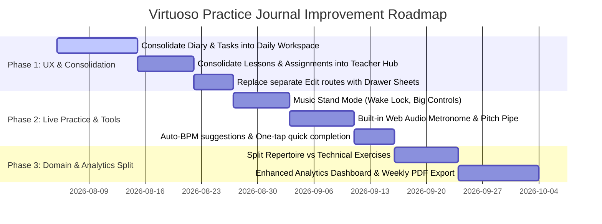

# Comprehensive Product & Architecture Improvement Report
## Virtuoso Practice Journal

**Date:** August 2026  
**Target Application:** Virtuoso Practice Journal (Local-first Music Practice Companion)  
**Scope:** UI, UX, Feature Additions, Feature Removals, Feature Consolidations, and Feature Splits.

---

## 1. Executive Summary

**Virtuoso** is a local-first web and mobile application designed for musicians to plan, execute, and track practice sessions, repertoire, technical exercises, lessons, and teacher assignments.

While the app possesses a clean design token system (terracotta, sage, gold, blue, plum) and a local-first IndexedDB architecture (Dexie), there are key opportunities to transform it into a **delightful, low-friction, indispensable daily music practice companion**.

This report outlines targeted recommendations across six dimensions:
1. **User Interface (UI)** — Visual refinement, typography hierarchy, mobile touch targets, and visual feedback.
2. **User Experience (UX)** — Reducing friction during active practice, improving keyboard/stand usability, and smoothing data entry.
3. **Features to Add** — Practice tools, repertoire deadlines, audio snippet recording, and teacher PDF exports.
4. **Features to Remove** — Redundant controls, unused modal states, and overly complex recurrence configurations for one-off tasks.
5. **Features to Consolidate** — Merging fragmented views (Diary + Tasks, Lessons + Assignments, Library + Collections).
6. **Features to Split** — Separating distinct workflows (Repertoire vs Technical Exercises, History Logs vs Analytics, Live Practice vs Quick Logging).

---

## 2. User Interface (UI) Improvements

### 2.1 Visual Hierarchy & Typography Refinement
* **Headline Font Contrast:** Leverage `Cormorant Garamond` for editorial page header titles, piece names, and milestone banners, while keeping `Inter`/`Manrope` strictly for quantitative data, tempos (BPM), timer displays, and form labels. Currently, serif titles sometimes conflict with dense tabular card data.
* **Subject Color Branding & Contrast:** Standardize subject color accents (terracotta, sage, gold, blue, plum) into subtle background tint badges and left border highlights (`border-l-4`), avoiding dark background fills that hinder readability on mobile devices under direct lighting.
* **Dark Mode & OLED Optimizations:** Provide a true pitch-black OLED dark mode option alongside the current muted dark theme to minimize battery drain when music stands use tablet screens on battery power for long practice sessions.

### 2.2 Navigation Bar & App Shell Ergonomics
* **Bottom Nav Bar Simplification:** Replace the 4-item + `Popover` ("More") bottom bar pattern with a clean, standard 5-tab bar (`Practice`, `Library`, `Lessons`, `Analytics`, `Profile`). The current popover for `History` and `Profile` requires two taps for high-frequency settings or history checks.
* **Drawer / Sheet Standardization for Mobile:** Replace desktop-styled modal dialogs with smooth, bottom swipeable drawers (using `Vaul` / `shadcn` Drawer) on mobile screens. Ensure form inputs in drawers handle mobile virtual keyboards cleanly (`useKeyboardInset`).

### 2.3 Visual Data & Feedback Polish
* **BPM & Mastery Sparklines:** Enhance the `BPMSparkline` and `MasterySparkline` components with interactive hover/tap tooltips showing historical dates and delta indicators (e.g. `+12 BPM over 14 days`).
* **Quality & Focus Rating Visuals:** Replace static star ratings with interactive haptic-feedback touch sliders or expressive 5-level mood chips (e.g. `Struggling 😖`, `Solid 😐`, `Flow State 🌊`, `Mastered ✨`).

---

## 3. User Experience (UX) Enhancements

### 3.1 Live Practice Mode (Music Stand Companion)
* **Always-On Screen Lock:** Implement Web Locks / Screen Wake Lock API (`navigator.wakeLock.request('screen')`) during active timer/practice mode to prevent the tablet or phone screen from dimming while instrument practice is underway.
* **Hands-Free & Large Touch Target Controls:** Enlarge play/pause/lap buttons to full-width touch zones (minimum 56px height) so musicians can tap the screen using their knuckles, palm, or elbow without laying down their instrument.
* **Hands-Free Gestures or Pedal Support:** Add Bluetooth page-turner / MIDI pedal event listeners (e.g. spacebar, PageDown, MIDI CC inputs) to start/pause timers or switch tasks while holding instruments (violin, cello, flute, guitar).

### 3.2 Friction Reduction in Practice Logging
* **One-Tap Task Completion & Quick Log:** Allow users to mark a task complete directly from the main list with auto-filled default duration (e.g. estimated time), requiring 0 modal opens for routine practice.
* **Smart Auto-Increment BPM Suggestion:** When completing a practice task linked to a repertoire piece or exercise, automatically propose incrementing the target BPM by +2 to +5 BPM if the session rating was rated 4 or 5 stars.

### 3.3 Seamless Offline & Local Storage Confidence
* **Sync & Local Storage Status Badge:** Display a discrete green offline-first status indicator ("All data saved locally") in the header to give users absolute confidence that their practice records are preserved without server connection requirements.
* **Undo Toast for Deletions:** Ensure all soft-deletions (`deletedAt`) trigger an immediate undo toast with a 5-second restoration window (`deleteWithUndo`).

---

## 4. Features to Add

### 4.1 Built-in Practice Tools (Metronome & Pitch Pipe)
* **Web Audio API Metronome:** Integrate a lightweight, precise Web Audio API metronome into the active practice overlay, allowing instant tempo selection and subdivision clicks without leaving the app.
* **Pitch Pipe / Reference Tones:** Add quick reference concert pitch generator (A440 / A442 Hz) for instrument tuning before beginning practice routines.

### 4.2 Repertoire Performance Goals & Target Dates
* **Event Countdown & Preparation Tracker:** Allow repertoire pieces to be linked to upcoming performance/audition dates (e.g. "Recital on Oct 15"). Show a readiness percentage based on target tempos, segment mastery ratings, and practice frequency.
* **Spaced Repetition Practice Suggestions:** Automatically suggest review dates for older, mastered repertoire to keep pieces performance-ready without manual task creation.

### 4.3 Audio Snippet Scratchpad
* **Short Audio Recording (Web Audio Recorder):** Allow musicians to capture 30-second audio snippets during practice sessions directly attached to a segment or task to track tone quality or difficult passage execution over time.

### 4.4 Teacher PDF & Digest Export
* **Weekly Practice Summary Export:** Generate a clean, single-page printable PDF summary containing total practice time, completed pieces, technical tempos, and teacher assignment notes to bring to weekly music lessons.

---

## 5. Features to Remove

### 5.1 Redundant Floating Action Buttons (FABs)
* **Floating Action Button Overlap:** Remove the overlapping floating action buttons on pages where header primary buttons already exist. Having both a `+ New Task` header button and a floating `SessionFAB` causes visual distraction and button overlap on mobile devices.

### 5.2 Over-Engineered Recurrence Rules for Simple Tasks
* **Complex Recurrence Modal:** Simplify task recurrence options for daily practice routines. Musicians usually need simple cadences (`Every Day`, `Weekdays`, `Every X Days`, `Specific Days of Week`). Remove complex RRULE-style edge cases that add form friction.

### 5.3 Standalone Edit Pages (Separate Route Overhead)
* **Deprecate `/tasks/:id/edit` and `/routines/:id/edit` Separate Routes:** Replace separate page routes for editing tasks and routines with slide-over drawer sheets. Navigating away from the main Diary view to edit a small detail disrupts the user's flow.

---

## 6. Features to Consolidate

### 6.1 Consolidate `Diary` and `Tasks` into an Integrated "Daily Practice Workspace"
* **Current Problem:** The app has both `/` (`Diary`) and `/tasks` (`Tasks`). Both manage daily practice routines, task execution, and timer sessions. Users are forced to navigate back and forth between planning tasks and executing sessions.
* **Consolidation Plan:** Merge both views into a unified **Daily Workspace**:
  - **Top Section:** Today's Practice Plan (Interactive Task List with quick start timers).
  - **Middle Section:** Quick Log / Active Session Card.
  - **Bottom Section:** Routine Generator & Calendar View switcher toggle (`Day view` / `Calendar view`).

### 6.2 Consolidate `Lessons` and `Assignments` into a "Teacher Hub"
* **Current Problem:** `/lessons` logs lesson history while `/assignments` manages assigned homework. Having them split breaks the context of preparing for and following up on teacher instructions.
* **Consolidation Plan:** Combine into a unified **Lessons & Assignments** view:
  - **Main View:** Active Assignments grouped by subject/teacher with due dates and checkboxes.
  - **History Tab:** Past lesson logs, snapshots, and teacher recap notes.

### 6.3 Consolidate `Collections` into `Library` (Playlists / Folders)
* **Current Problem:** `/collections` lives as a separate top-level domain entity and page, separate from `/library`. Collections are essentially custom playlists or folders of library items (e.g. "Scales Routine", "Beethoven Sonata").
* **Consolidation Plan:** Nest Collections inside the **Library** view as custom views/playlists (`All Items`, `By Subject`, `Collections / Folders`).

---

## 7. Features to Split

### 7.1 Split `Library` into `Repertoire` (Works) vs `Technical Exercises & Theory`
* **Current Problem:** Repertoire pieces (e.g. Bach Chaconne) share the same entity list view as technical exercises (e.g. Carl Flesch Scale System, Hanon #1) and theory work, despite having vastly different workflows, mastery metrics, and segment structures.
* **Split Plan:**
  - **Repertoire Tab:** Multi-movement pieces, performance dates, composer metadata, movement-level mastery, target dates.
  - **Technical Exercises & Routine Bank:** Scales, arpeggios, etudes, tone exercises categorized by subject and target BPM goals.

### 7.2 Split `History` into `Session Logs` vs `Analytics & Insights`
* **Current Problem:** `/history` attempts to combine a detailed audit log of past practice sessions with high-level analytical charts (heatmaps, subject time distributions, streak metrics).
* **Split Plan:**
  - **Analytics Tab (Primary):** Visual insights, weekly graphs, tempo progress curves, practice balance by subject.
  - **Session Log Sub-View / Drawer:** Detailed chronologically ordered list of raw past sessions with edit/delete capability.

### 7.3 Split `Practice Logging` into `Quick Post-Facto Log` vs `Live Practice Companion`
* **Current Problem:** The current session log modal forces live active timer users and post-practice logger users into the exact same form UI.
* **Split Plan:**
  - **Live Practice Companion:** Full-screen minimal UI focused on timer, metronome, current segment focus, auto-save screen.
  - **Quick Add Entry:** Compact, 3-field form (`Item`, `Duration`, `Notes`) for logging practice after the fact in under 5 seconds.

---

## 8. Prioritized Implementation Roadmap

### Action Plan Summary Matrix

| Recommendation | Category | Priority | User Impact | Effort |
|---|---|---|---|---|
| Consolidate `Diary` + `Tasks` into Daily Workspace | Consolidation | **High** | Eliminates dual-navigation confusion; 50% fewer clicks daily | Medium |
| Music Stand Mode (Wake Lock & Large Controls) | UX | **High** | Essential for hands-free instrument practice | Low |
| Built-in Web Audio Metronome | Feature Addition | **High** | Keeps user inside app during active practice | Medium |
| Consolidate `Lessons` + `Assignments` | Consolidation | **Medium** | Unified context for teacher follow-up | Low |
| Split `Repertoire` vs `Technical Exercises` | Feature Split | **Medium** | Tailors metrics to pieces vs scales | Medium |
| Remove Standalone Edit Routes for Drawers | Feature Removal | **Medium** | Faster workflow; keeps context | Low |
| Printable Weekly Lesson Summary PDF | Feature Addition | **Low** | High value for students with teachers | Medium |

---

*Report prepared for Virtuoso Practice Journal codebase.*
